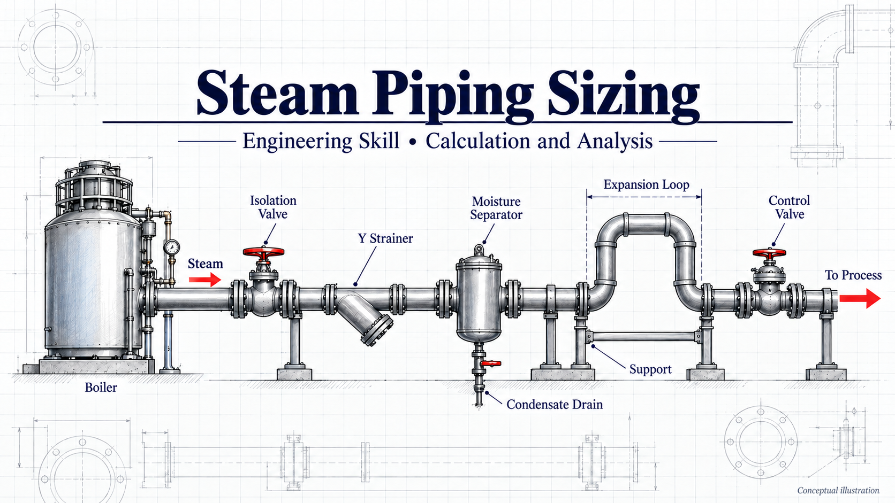
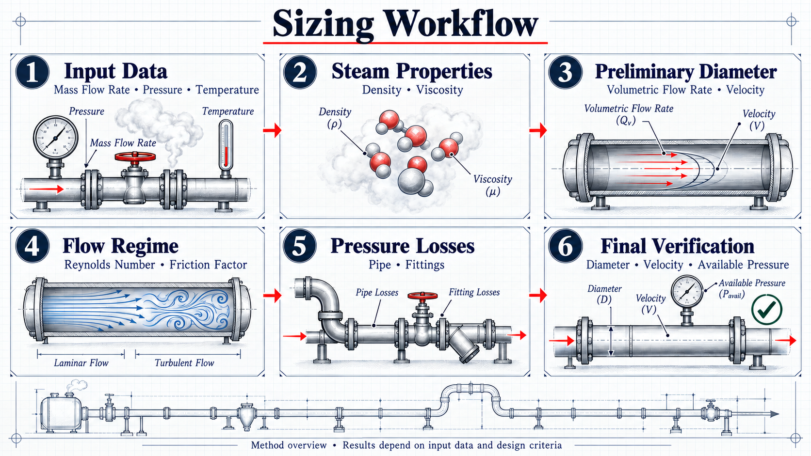

# Steam Piping Sizing



**Languages:** English · [Português (BR)](#português-br) · [Español](#español)

A trilingual agent skill for **sizing and verifying steam piping**: diameter from velocity, Reynolds number, friction factor, Darcy-Weisbach distributed loss, local losses via K coefficients, total pressure drop, and the field practice that makes a steam line actually work.

Uma skill de agente trilíngue para **dimensionar e verificar tubulação de vapor**: diâmetro por velocidade, Reynolds, fator de atrito, perda distribuída de Darcy-Weisbach, perdas localizadas por coeficientes K, queda de pressão total e a prática de campo que faz a linha funcionar.

Una skill de agente trilingüe para **dimensionar y verificar tubería de vapor**: diámetro por velocidad, Reynolds, factor de fricción, pérdida distribuida de Darcy-Weisbach, pérdidas locales por coeficientes K, caída de presión total y la práctica de campo que hace funcionar la línea.

## Sizing workflow



The six stages summarize the detailed procedure in [the English skill](SKILL.md), [Português (BR)](SKILL.pt-BR.md) and [Español](SKILL.es.md). Use the written procedure and calculator for the actual checks, including erosion, Mach number and allowable pressure drop.

## Industrial steam system


Conceptual illustration, not to scale: component quantities, routing and support details do not define a construction design. The worked example specifies its own fittings and operating data: [English](examples/steam-8bar-2500kgh.en.md), [Português (BR)](examples/steam-8bar-2500kgh.pt-BR.md), [Español](examples/steam-8bar-2500kgh.es.md).

## Repository contents / Conteúdo / Contenido

| Content | English | Português (BR) | Español |
|---|---|---|---|
| Skill | [`SKILL.md`](SKILL.md) | [`SKILL.pt-BR.md`](SKILL.pt-BR.md) | [`SKILL.es.md`](SKILL.es.md) |
| Reference tables | [`references/tables.en.md`](references/tables.en.md) | [`references/tables.pt-BR.md`](references/tables.pt-BR.md) | [`references/tables.es.md`](references/tables.es.md) |
| Worked example | [`examples/steam-8bar-2500kgh.en.md`](examples/steam-8bar-2500kgh.en.md) | [`examples/steam-8bar-2500kgh.pt-BR.md`](examples/steam-8bar-2500kgh.pt-BR.md) | [`examples/steam-8bar-2500kgh.es.md`](examples/steam-8bar-2500kgh.es.md) |
| Calculator | `tools/calc-steam.mjs` — one file, all languages via `--lang en\|pt\|es` | | |

The three skill documents are **equivalent translations**: same frameworks, same numbers, same tables. Read whichever you prefer; the calculator serves all three.

---

## English

### What this is

A 10-step steam-pipe sizing procedure (system data → steam properties → volumetric flow → diameter by velocity → Reynolds → Swamee-Jain friction factor → Darcy-Weisbach → K coefficients → total loss and ΔP → good practice), derived from a field calculation sheet and **completed with the verifications that sheet omits**: erosion limits, Mach number, allowable ΔP as a percentage of absolute pressure, unit traps, and an independent cross-check of the pressure drop.

### Install as a skill

```bash
git clone https://github.com/C48H74/steam-piping-sizing.git \
  ~/.agents/skills/steam-piping-sizing
```

Windows:

```powershell
git clone https://github.com/C48H74/steam-piping-sizing.git "$env:USERPROFILE\.agents\skills\steam-piping-sizing"
```

Then ask your agent something like *"size the steam line: 2,500 kg/h at 8 bar(g), 45 m, 6 long-radius elbows, 2 gate valves, 1 control valve, 1 Y-strainer and 1 moisture separator."*

### Use the calculator

```bash
node tools/calc-steam.mjs --lang en --m 2500 --rho 4.81 --mu 1.34e-5 --L 45 --eps 0.045 --K 14.1 --Pabs 9.013
```

`--lang` accepts `en` (default), `pt` or `es` and changes only the labels — the numbers are identical in all three.

To force a known diameter (and reproduce an existing case), pass `--D` in mm:

```bash
node tools/calc-steam.mjs --m 2500 --rho 4.81 --L 45 --K 14.1 --Pabs 9.013 --D 77.9
```

Run with `--help` for every option. Density is **never** computed from P and T on purpose: take it from a steam table (`references/tables.en.md`).

### Scope and limits

Steady state, incompressible flow (Ma < 0.3), Newtonian fluid, constant circular section.

**Not** covered: flexibility analysis and nozzle reactions; wall thickness and pressure classes (ASME B31.3); steam trap sizing; thermal insulation and tracing; control valve Cv sizing; two-phase flow and condensate flashing; transients and water hammer.

All tables are **typical design values** — confirm against the project specification and the applicable code before issuing any document.

---

## Português (BR)

### O que é

Um procedimento de dimensionamento de linha de vapor em 10 etapas (dados do sistema → propriedades do vapor → vazão volumétrica → diâmetro por velocidade → Reynolds → fator de atrito de Swamee-Jain → Darcy-Weisbach → coeficientes K → perda total e ΔP → boas práticas), derivado de uma folha de cálculo de campo e **completado com as verificações que ela não faz**: limite de erosão, número de Mach, ΔP admissível como porcentagem da pressão absoluta, armadilhas de unidade e uma conferência independente da perda de carga.

### Instalar como skill

```powershell
git clone https://github.com/C48H74/steam-piping-sizing.git "$env:USERPROFILE\.agents\skills\steam-piping-sizing"
```

Depois peça ao agente algo como *"dimensione a linha de vapor: 2,500 kg/h a 8 bar(g), 45 m, 6 curvas de raio longo, 2 gavetas, 1 válvula de controle, 1 filtro Y e 1 separador de umidade"*.

### Usar a calculadora

```bash
node tools/calc-steam.mjs --lang pt --m 2500 --rho 4.81 --mu 1.34e-5 --L 45 --eps 0.045 --K 14.1 --Pabs 9.013
```

`--lang` aceita `en` (padrão), `pt` ou `es` e altera apenas os rótulos — os números são idênticos nos três.

Para forçar um diâmetro conhecido (e reproduzir um caso existente), use `--D` em mm:

```bash
node tools/calc-steam.mjs --m 2500 --rho 4.81 --L 45 --K 14.1 --Pabs 9.013 --D 77.9
```

`--help` lista todas as opções. A massa específica **não** é calculada a partir de P e T de propósito: ela deve vir de tabela de vapor (`references/tables.pt-BR.md`).

### Escopo e limites

Regime permanente, escoamento incompressível (Ma < 0.3), fluido newtoniano, seção circular constante.

**Não** cobre: análise de flexibilidade e reações em bocais; espessura de parede e classes de pressão (ASME B31.3); dimensionamento de purgadores; isolamento térmico e traçamento; dimensionamento de válvula de controle por Cv; escoamento bifásico e flash de condensado; transientes e golpe de aríete.

As tabelas são **valores usuais de projeto** — confirme contra a especificação do projeto e a norma aplicável antes de emitir documento.

---

## Español

### Qué es

Un procedimiento de dimensionamiento de línea de vapor en 10 pasos (datos del sistema → propiedades del vapor → caudal volumétrico → diámetro por velocidad → Reynolds → factor de fricción de Swamee-Jain → Darcy-Weisbach → coeficientes K → pérdida total y ΔP → buenas prácticas), derivado de una hoja de cálculo de campo y **completado con las verificaciones que esa hoja no hace**: límite de erosión, número de Mach, ΔP admisible como porcentaje de la presión absoluta, trampas de unidades y una comprobación independiente de la pérdida de carga.

### Instalar como skill

```bash
git clone https://github.com/C48H74/steam-piping-sizing.git \
  ~/.agents/skills/steam-piping-sizing
```

Windows:

```powershell
git clone https://github.com/C48H74/steam-piping-sizing.git "$env:USERPROFILE\.agents\skills\steam-piping-sizing"
```

Luego pida a su agente algo como *"dimensiona la línea de vapor: 2,500 kg/h a 8 bar(g), 45 m, 6 codos de radio largo, 2 válvulas de compuerta, 1 válvula de control, 1 filtro Y y 1 separador de humedad"*.

### Usar la calculadora

```bash
node tools/calc-steam.mjs --lang es --m 2500 --rho 4.81 --mu 1.34e-5 --L 45 --eps 0.045 --K 14.1 --Pabs 9.013
```

`--lang` acepta `en` (por defecto), `pt` o `es` y cambia solo las etiquetas — los números son idénticos en los tres.

Para forzar un diámetro conocido (y reproducir un caso existente), use `--D` en mm:

```bash
node tools/calc-steam.mjs --m 2500 --rho 4.81 --L 45 --K 14.1 --Pabs 9.013 --D 77.9
```

`--help` lista todas las opciones. La densidad **no** se calcula a partir de P y T a propósito: debe tomarse de una tabla de vapor (`references/tables.es.md`).

### Alcance y límites

Régimen permanente, flujo incompresible (Ma < 0.3), fluido newtoniano, sección circular constante.

**No** cubre: análisis de flexibilidad y reacciones en boquillas; espesor de pared y clases de presión (ASME B31.3); dimensionamiento de purgadores; aislamiento térmico y trazado; dimensionamiento de válvula de control por Cv; flujo bifásico y flash de condensado; transitorios y golpe de ariete.

Las tablas son **valores usuales de proyecto** — confirme contra la especificación del proyecto y la norma aplicable antes de emitir documento.

---

## License / Licença / Licencia

MIT — see [`LICENSE`](LICENSE).
