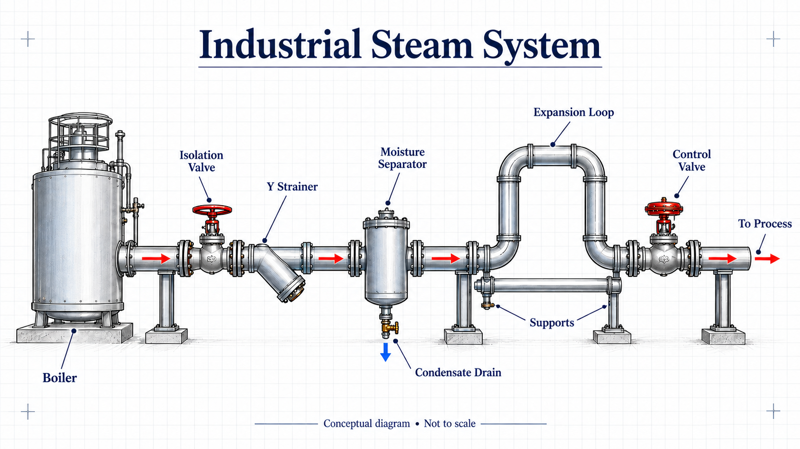

# Steam line — corrected sizing and verification

[English](steam-8bar-2500kgh.en.md) · [Português](steam-8bar-2500kgh.pt-BR.md) · [Español](steam-8bar-2500kgh.es.md)



Caso de trazabilidad de la hoja original: densidad y viscosidad se conservan solo para reproducir el cálculo histórico, sin certificar el estado termodinámico. Aquí 8 bar(g) corresponde a 9,013 bar(a). Confirme propiedades y presión atmosférica local antes de diseñar.

## Inputs

| Quantity | Value |
|---|---:|
| Steam flow | 2500 kg/h |
| Density | 4.81 kg/m³ |
| Dynamic viscosity | 1.34e-5 Pa·s |
| Length | 45 m |
| Roughness | 0.045 mm |
| Sum K | 14.1 (preliminary historical fitting coefficients) |
| Inlet absolute pressure | 9.013 bar |
| Sound-speed estimate | T=175 °C, k=1.3; ideal approximation |

## Results

| Case | Size | ID mm | V m/s | ΔP bar | Status |
|---|---|---:|---:|---:|---|
| Automatic / Vmax 30 | DN90 | 90.1 | 22.644 | 0.280889 | PASS |
| DN80 / Vmax 30 | custom | 77.9 | 30.292 | 0.537949 | FAIL |
| DN80 / Vmax 40 | custom | 77.9 | 30.292 | 0.537949 | PASS |
| DN80 / max drop 0.5 bar | custom | 77.9 | 30.292 | 0.537949 | FAIL |
| Automatic / max drop 0.1 bar | DN125 | 128.2 | 11.185 | 0.059985 | PASS |
| Sch 80 / Vmax 30 | DN90 | 85.4 | 25.205 | 0.356489 | PASS |

## Interpretation

DN80 does not satisfy a hard 30 m/s maximum: its bore 77.9 mm is smaller than the required 78.278 mm. A separately documented 40 m/s maximum can accept its velocity; a 0.5 bar budget still rejects its 0.537949 bar loss. No arbitrary exception for a control valve makes that pressure budget pass. DN90 exists in the expanded catalog; projects that do not procure it must remove it from the custom candidate catalog, in which case the next size is DN100.

## Independent arithmetic checks

For explicit D=77.9 mm: Q=0.144375 m³/s; V≈30.291 m/s; Re≈8.470e5. Colebrook solves the implicit friction equation. Both `ΔP=(fL/D+K)ρV²/2` and `ΔP=f(L+KD/f)/D·ρV²/2` give ≈53794.86 Pa. Numerical agreement is not thermodynamic or code certification.

## Reproduce

```bash
node tools/calc-vapor.mjs --m 2500 --rho 4.81 --mu 1.34e-5 --L 45 --eps 0.045 --K 14.1 --Pabs 9.013 --T 175 --lang es --all
node tools/calc-vapor.mjs --m 2500 --rho 4.81 --mu 1.34e-5 --L 45 --eps 0.045 --K 14.1 --Pabs 9.013 --T 175 --D 77.9 --V 40 --lang es
node tools/calc-vapor.mjs --m 2500 --rho 4.81 --mu 1.34e-5 --L 45 --eps 0.045 --K 14.1 --Pabs 9.013 --T 175 --D 77.9 --V 40 --dp-max 0.5 --lang es
```

The last command deliberately returns exit code 3 (FAIL). See [design basis](../references/design-basis.md).
